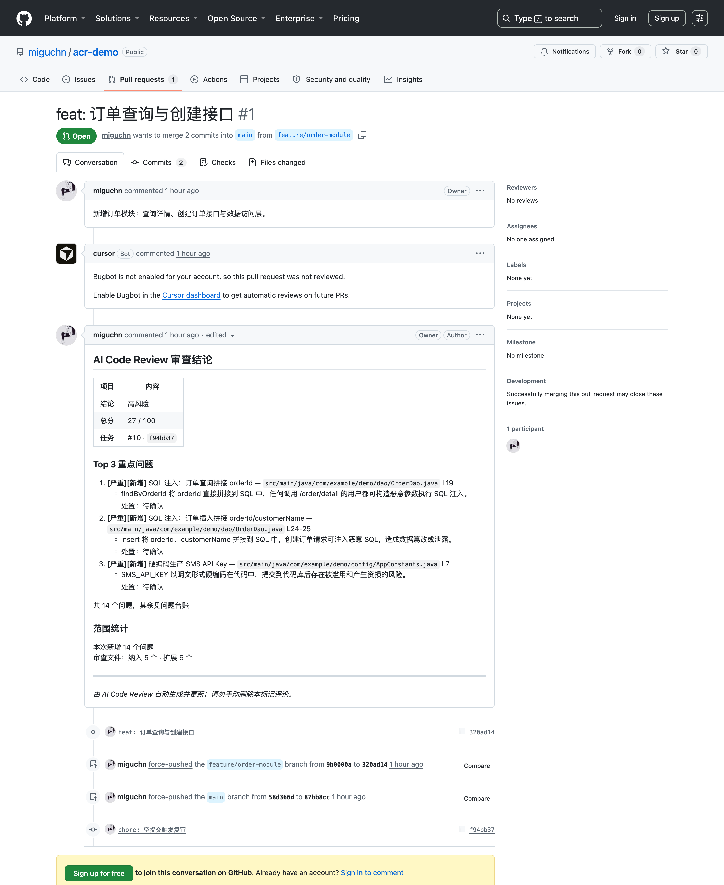
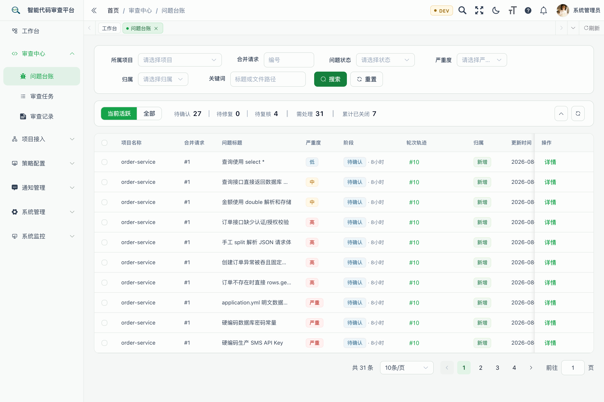
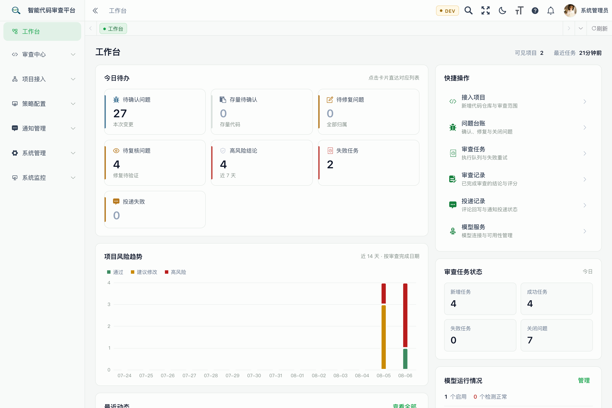

<div align="center">
  <h1>AI Code Review</h1>
  <h4>Review code automatically. Follow issues through to resolution.</h4>
  <p>An open-source, self-hosted code review platform for enterprise engineering teams.</p>
  <p>
    <a href="LICENSE"></a>
    
    
    
    
  </p>
  <p>English | <a href="README.md">简体中文</a></p>
</div>

AI Code Review receives PR/MR and push events, reviews code with your configured model, posts results to the Git platform, and sends group notifications. Teams can assign, track, verify, and close issues. Authorized managers can view project quality and model usage.

[See a real demo PR](https://github.com/miguchn/acr-demo/pull/1#issuecomment-5201536018): the sample code includes SQL injection and hardcoded credentials. The platform generated and updated the review comment during an actual run.

## Capabilities

| Capability | How it works |
| --- | --- |
| Connect repositories | GitHub, GitLab, Gitee, and Gitea adapters, with project, branch, and review scope settings |
| Review automatically | Trigger on PR/MR updates or pushes to selected branches; use direct model review or open-code-review |
| Read results | Scores, key findings, code locations, and suggested fixes, with configuration and results saved for each run |
| Post comments | Update one summary comment per PR/MR; optionally post inline comments for key findings |
| Notify teams | DingTalk, WeCom, and Feishu group bots, with notification conditions, cooldowns, and delivery retries |
| Follow up issues | Auto-assignment, overdue reminders, confirmation, remediation, recheck, closure, dismissal, and false-positive handling |
| Control access | Access constrained by functional permissions, department scope, and project roles; encrypted credentials |
| View quality | Project and member statistics, trends, Token usage, and estimated costs at current model prices |
| Operate the service | Queue, failure, and dependency visibility, with persistent scheduling, retries, and recovery |

GitHub has a recorded acceptance run against a real repository. GitLab, Gitee, and Gitea have adapter and contract-test coverage; validate the actual instances you will use during deployment. Push reviews find issues after submission. Risk conclusions do not automatically block merges. Costs are estimates, and member statistics support engineering improvement.

Code context is sent to the model service you configure. Before connecting enterprise repositories, confirm your team's approved model, network, and data-processing boundaries.

## Screenshots

**Review results posted to a PR**

<p align="center"></p>

**Issue tracking**

<p align="center"></p>

**Workbench**

<p align="center"></p>

## Quick Start

Install Docker Engine and Compose v2. Host port 80 must be available.

```bash
cp .env.example .env
openssl rand -base64 32
# Put the generated value in ACR_CREDENTIAL_MASTER_KEY in .env
docker compose up -d --build
docker compose ps
```

Once all four services are `healthy`, open <http://127.0.0.1>, sign in with `admin / admin123`, and change the password. The default Compose stack is configured for local evaluation. For team deployment, follow the [deployment guide](docs/deployment.md) to configure HTTPS, separate secrets, database permissions, and backups, then complete [deployment acceptance](docs/planning/v1-release-readiness.md). These operational documents are currently in Chinese.

### Connect Your First Repository

1. Add a model under `策略配置 → 大模型配置` and test the model call.
2. Add a Git platform Token under `项目接入 → 访问凭据`. Create a code project and choose its branch, template, and review mode.
3. Test the project connection, enable the project, and copy its Webhook URL and Secret into the Git platform settings.
4. Create or update a PR/MR, then check the task, Git platform comment, and issue list.
5. For group notifications, add a bot channel and bind it to the project. For push reviews, configure the trigger branches.

These menu paths match the current interface. The built-in `功能助手` provides step-by-step guidance. The interface and built-in help are primarily in Chinese.

Set `ACR_WEBHOOK_CALLBACK_URL` to an address reachable by the Git platform. Set `review.ui.base-url` to the frontend address reachable by your team for notification links. The default backend image includes open-code-review CLI `1.11.6`; local Java deployments must install it as described in the deployment guide.

Back up an existing database before upgrading and apply only missing incremental scripts from the [SQL guide](sql/README.md). Use `init-full.sql` for new installations only: it recreates tables.

## Documentation and Development

The backend uses Java 17, Spring Boot 4, MyBatis, MySQL, and Redis. The frontend uses Vue 3. Core review logic lives in `acr-review`; see the [architecture guide](docs/planning/architecture-scaffold.md) for module boundaries.

| Document | Contents |
| --- | --- |
| [Deployment guide](docs/deployment.md) | Installation, connection settings, upgrades, and production conditions |
| [Deployment acceptance](docs/planning/v1-release-readiness.md) | Verified capabilities, remaining functionality, and environment checks |
| [SQL guide](sql/README.md) | New installation and incremental upgrades |
| [Changelog](CHANGELOG.md) | Delivered features and fixes |
| [Product roadmap](docs/planning/product-roadmap.md) | Planned work and acceptance criteria |
| [Contributing](CONTRIBUTING.md) / [Security policy](SECURITY.md) | Development and vulnerability reporting |

Before submitting changes, run `mvn test`, `cd acr-ui && npm run test:unit`, and `npm run build:prod`. New business features need a defined scope, permission model, and acceptance criteria.

Licensed under [Apache License 2.0](LICENSE). Third-party components retain their own licenses.
